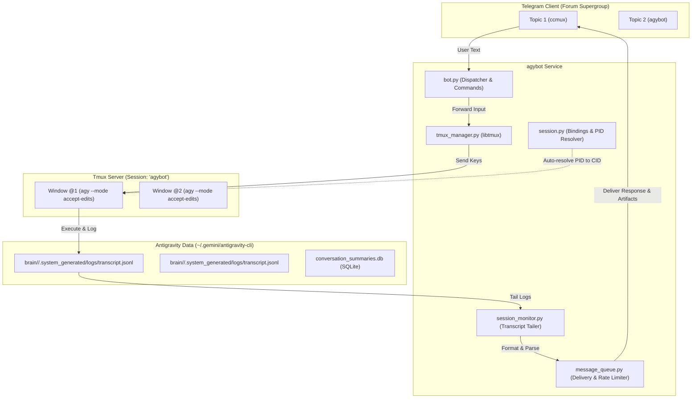

# agybot

> **Telegram Bot bridging Telegram Forum Topics to Google Antigravity (`agy`) sessions via Tmux windows.**

Each forum topic in Telegram is bound to exactly one tmux window running one autonomous Antigravity instance in `--mode accept-edits`.

---

## 🌟 Key Features

- **1 Topic = 1 Window = 1 Session**: Pure 1:1 mapping between Telegram forum topics and Antigravity tmux windows.
- **Dedicated to Antigravity (`agy`)**: Clean codebase with zero legacy cruft. Designed natively for Antigravity's JSONL transcripts and SQLite session databases.
- **Accept-Edits Mode**: Automatically launches new windows with `agy --mode accept-edits --dangerously-skip-permissions` for seamless autonomous coding.
- **Hook-Free Conversation Auto-Resolution**: No external hooks required! Auto-detects conversation IDs in milliseconds by tracing process PIDs and CLI logs.
- **Interactive Terminal Prompts**: Automatically renders inline keyboards for Antigravity `ask_question` choices, confirmation menus, and arrows.
- **Artifacts Auto-Delivery**: Automatically identifies and sends generated markdown artifacts and documents directly to Telegram.
- **High-Fidelity Terminal Screenshots**: Render dark-themed PNG screenshots of active tmux panes with full ANSI color support and font fallbacks (`JetBrains Mono` → `Noto Sans CJK` → `Symbola`).
- **One-Click Interactive Deploy**: `deploy.sh` script with beautiful CLI styling, dependency checks, token validation, and systemd service generation.

---

## 🏗️ Architecture



---

## 🚀 One-Click Deployment

To deploy or configure `agybot`, simply run:

```bash
cd /root/agybot
bash deploy.sh
```

The script will:
1. Verify system dependencies (`python3`, `tmux`, `uv`, `agy`).
2. Interactively prompt for your Telegram Bot Token and Allowed User IDs.
3. Configure startup options (mode, display preferences).
4. Sync dependencies into `.venv` using `uv`.
5. Optionally install and start `agybot` as a `systemd` background service.

---

## 📱 Telegram Commands Reference

| Command | Description |
| :--- | :--- |
| `/start` | Welcome message and instructions |
| `/screenshot` | Captures terminal pane as a high-res image with interactive buttons |
| `/artifacts` | Downloads all `.md` and code artifacts generated in the session |
| `/history` | View paginated conversation history in the current topic |
| `/esc` | Sends an Escape interrupt to halt current agent execution |
| `/clear` | Clears conversation context (`/clear`) |
| `/usage` | Displays session ID, title, message count, and workspace path |
| `/unbind` | Unbinds topic from tmux window (keeps window running in tmux) |
| `/kill` | Terminates tmux window and unbinds topic |

---

## ⚙️ Configuration (`.env`)

Configuration is stored in `/root/agybot/.env` (and synced to `~/.agybot/.env`):

```bash
# Telegram Bot Token from @BotFather (required)
TELEGRAM_BOT_TOKEN="your_token_here"

# Allowed Telegram User IDs (comma-separated, required)
ALLOWED_USERS="123456789"

# Tmux session name (defaults to "agybot")
TMUX_SESSION_NAME="agybot"

# Antigravity command executed in new windows
AGY_COMMAND="agy --mode accept-edits --dangerously-skip-permissions"

# Polling interval in seconds
MONITOR_POLL_INTERVAL=1.5

# Display preferences (false to keep chat clean)
AGYBOT_SHOW_TOOL_CALLS=false
AGYBOT_SHOW_THINKING=false
AGYBOT_SHOW_USER_MESSAGES=false
AGYBOT_AUTO_RENAME_TOPICS=true
```

---

## 🛠️ Service Management

```bash
# Restart agybot
./scripts/restart.sh

# If using systemd:
sudo systemctl restart agybot
sudo systemctl status agybot
journalctl -u agybot -f
```
