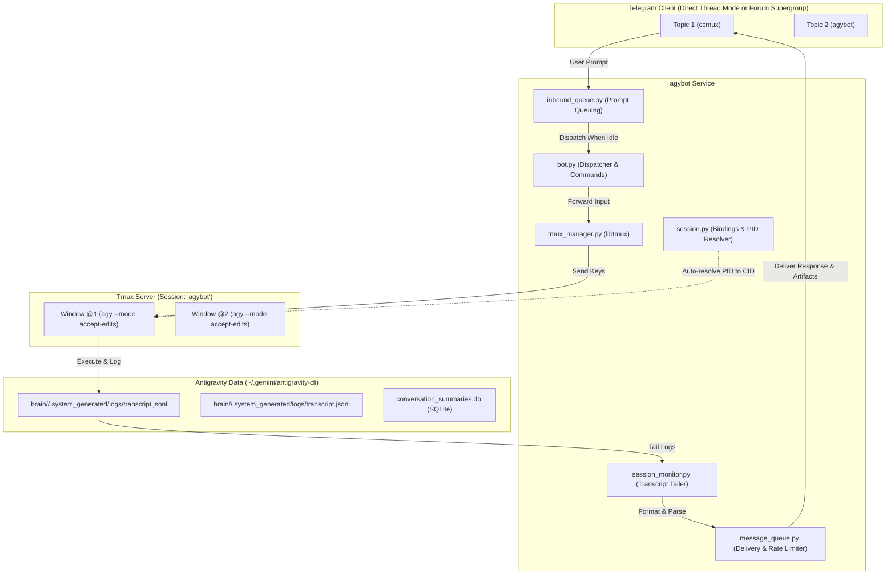

# agybot

[](https://opensource.org/licenses/MIT)
[](https://python.org)
[](https://astral.sh/uv)

> **Telegram Bot bridging Telegram Forum Topics & Direct Bot Threads to Google Antigravity (`agy`) CLI sessions via Tmux windows.**

Each topic or thread (whether in 1-on-1 Direct Chat with Thread Mode on, or in a Forum Supergroup) is bound 1:1 to a tmux window running an autonomous Antigravity instance in `--mode accept-edits`.

---

## 🌟 Key Features

- **1 Topic = 1 Window = 1 Session**: Pure 1:1 mapping between Telegram forum topics and Antigravity tmux windows.
- **Dedicated to Antigravity (`agy`)**: Clean codebase with zero legacy cruft. Designed natively for Antigravity's JSONL transcripts and SQLite session databases.
- **Accept-Edits Mode**: Automatically launches new windows with `agy --mode accept-edits --dangerously-skip-permissions` for seamless autonomous coding.
- **Hook-Free Conversation Auto-Resolution**: No external hooks required! Auto-detects conversation IDs in milliseconds by tracing process PIDs and CLI logs.
- **Inbound Prompt Queuing**: Send follow-up prompts anytime while Antigravity is busy. Prompts are queued and automatically dispatched one-by-one as each task completes.
- **Collapsible Model Thinking**: Model chain-of-thought blocks are dynamically consolidated and edited in-place inside a single expandable Telegram blockquote per turn (`💭 Thought`).
- **Interactive Terminal Prompts**: Automatically renders inline keyboards for Antigravity `ask_question` choices, confirmation menus, and arrows.
- **Live Ephemeral Tool & Edit Status**: In-place single-message status tracker with rotating spinner showing exact running commands and file edits, automatically disappearing upon final response to prevent chat clutter.
- **Inbound Image & File Attachments**: Drop photos and documents directly into Telegram; agybot saves them to `<workspace>/attachments/` and seamlessly references them in the agent's prompt.
- **Build Output & Artifacts Auto-Delivery**: Automatically detects and delivers `.apk`, `.aab`, and `.ipa` build binaries ($\le 48\text{ MB}$) alongside markdown artifacts, with path alerts for oversized binaries.
- **High-Fidelity Terminal Screenshots**: Render dark-themed PNG screenshots of active tmux panes with full ANSI color support and font fallbacks (`JetBrains Mono` → `Noto Sans CJK` → `Symbola`), with inline **Refresh** and **Close** controls.
- **One-Click Interactive Deploy**: `deploy.sh` script with beautiful CLI styling, dependency checks, token validation, and systemd service generation.

---

## 🏗️ Architecture



---

## 📋 Prerequisites

1. **Linux OS**: Ubuntu 22.04+, Debian 12+, or any modern Linux distribution.
2. **Tmux**: Terminal multiplexer (`sudo apt install tmux`).
3. **Python 3.12+** & **uv**: Fast Python package installer (`curl -LsSf https://astral.sh/uv/install.sh | sh`).
4. **Google Antigravity CLI**: `agy` installed and accessible in `PATH`.
5. **Telegram Bot Token**: Created via [@BotFather](https://t.me/BotFather).
6. **Telegram Chat with Topics/Threads**: Use agybot either directly in **1-on-1 private chat with thread mode enabled**, or in a **Forum Supergroup** with topics enabled.

---

## 🚀 Quickstart & One-Click Deployment

Clone the repository and run the automated interactive deployment script:

```bash
git clone https://github.com/ngatomgyi/agybot.git
cd agybot
bash deploy.sh
```

The script will:
1. Verify system dependencies (`python3`, `tmux`, `uv`, `agy`).
2. Interactively prompt for your Telegram Bot Token and Allowed User IDs.
3. Configure display preferences (tool execution, thinking collapsible quotes).
4. Sync dependencies into `.venv` using `uv`.
5. Optionally install and start `agybot` as a `systemd` background service.

---

## 📱 Telegram Commands Reference

| Command | Description |
| :--- | :--- |
| `/start` | Welcome message and instructions |
| `/screenshot` | Captures terminal pane as a high-res image with inline Refresh and Close buttons |
| `/artifacts` | Downloads all `.md` and build binary artifacts generated in the session |
| `/history` | View paginated conversation history in the current topic |
| `/queue` | View prompts currently queued for this topic |
| `/esc` | Sends an Escape interrupt to halt current agent execution |
| `/clear` | Clears conversation context in Antigravity (`/clear`) |
| `/usage` | Displays active model, agent mode & effort, token breakdown (input, output, cached, total), step count, title, and workspace |
| `/caveman` | Toggle or check Caveman compressed mode (`/caveman on`, `/caveman off`, `/caveman full`) |
| `/unbind` | Unbinds topic from tmux window (keeps window running in tmux) |
| `/close` | Alias for `/kill`: terminates tmux window and unbinds topic |
| `/kill` | Terminates tmux window and unbinds topic |

---

## ⚙️ Configuration (`.env`)

Configuration is stored in `.env` in the working directory (and synced to `~/.agybot/.env`):

```bash
# Telegram Bot Token from @BotFather (required)
TELEGRAM_BOT_TOKEN="your_token_here"

# Allowed Telegram User IDs (comma-separated, required)
ALLOWED_USERS="123456789"

# Tmux session name (defaults to "agybot")
TMUX_SESSION_NAME="agybot"

# Antigravity command executed in new windows
AGY_COMMAND="agy --mode accept-edits --dangerously-skip-permissions"

# Caveman token-saving mode ("full" or "off")
CAVEMAN_DEFAULT_MODE="full"

# Polling interval in seconds
MONITOR_POLL_INTERVAL=1.5

# Display preferences in Telegram
AGYBOT_SHOW_TOOL_CALLS=true
AGYBOT_SHOW_THINKING=true
AGYBOT_SHOW_USER_MESSAGES=false
AGYBOT_AUTO_RENAME_TOPICS=true
```

---

## 🛠️ Service Management

```bash
# Restart agybot manually
./scripts/restart.sh

# If installed with systemd:
sudo systemctl restart agybot
sudo systemctl status agybot
journalctl -u agybot -f
```

---

## 🧪 Development & Testing

```bash
# Install dependencies
uv sync

# Run tests
uv run pytest

# Check formatting and linting
uv run ruff check
uv run ruff format --check
```

---

## 📄 License

This project is licensed under the [MIT License](LICENSE).
